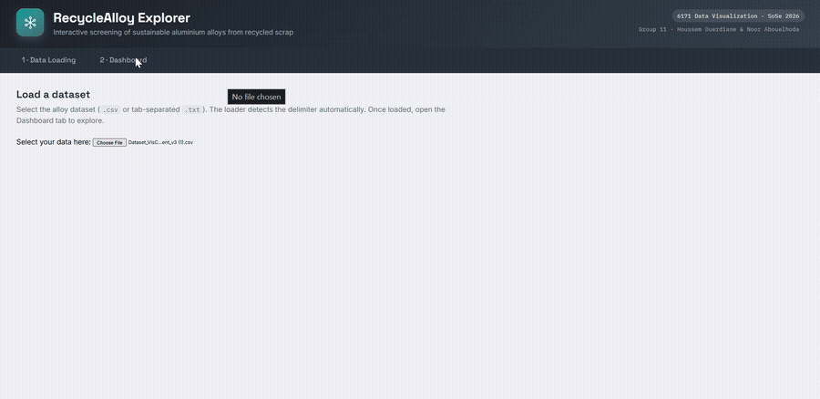

# RecycleAlloy Explorer

An interactive D3.js dashboard for exploring a large simulated dataset of sustainable aluminium alloys made from
recycled scrap. It shows how scrap mixing ratios, chemistry and microstructure drive an alloy's mechanical and
thermophysical properties, so engineers can shortlist promising recipes.



[Full demo video](docs/demo.mp4) · [Static screenshot](docs/screenshot.png)

## Features

- **Six linked, animated views:** pin an alloy in one view and every other view updates.
- **Global filter bar:** range sliders for the six scrap sources (KS1295 piston alloy, 6082, 2024, battery box,
  3003, 4032).
- **Alloy pinning:** compare up to seven colour-coded alloys side by side.
- **Correlation analysis:** least-squares trend lines with Pearson's r.
- **Large files in the browser:** handles datasets of ~324,000 rows × 70 columns (~190 MB).
- **No build step, no server:** plain HTML, JavaScript and D3 v7.

## The six views

| # | View | What it shows | Why this encoding |
|---|---|---|---|
| 1 | Design-Space Scatter | Any scrap ratio or phase fraction (x) against any of the 14 properties (y), with zoom, pan and tooltips | Real measured values with no projection, answering "how does this input affect that property?" |
| 2 | Composition Ribbon | A 100%-wide band per pinned alloy, switching between scrap sources, elements and microstructure phases | Composition is part-to-whole, and the three modes link recipe → chemistry → microstructure |
| 3 | Mechanical Radar | Yield strength, hardness and hot-crack susceptibility on a normalised three-axis radar | With exactly three objectives, shape comparison is immediate |
| 4 | Thermophysical Strips | One track per thermophysical property (11), showing where each pinned alloy sits in the dataset range | Too many axes for a radar; position on a common scale is read most accurately |
| 5 | Correlation Explorer | Any input against any property, with a trend line, Pearson's r and a plain-language strength label | Turns "which factors matter?" into a number |
| 6 | Multi-Alloy Comparison | Grouped bars for all pinned alloys over a chosen subset of properties, normalised 0–100% | The side-by-side view for a final shortlist |

## Data handling

- **Automatic column grouping:** columns are sorted into scraps, elements, phases, mechanical and thermophysical
  properties (`detectColumns` in `dashboard.js`), tolerating differences in spacing and capitalisation.
- **Missing values are kept:** a NaN can mean a phase that does not form or a simulation that did not converge.
  Rows are never dropped; each view skips only the missing values in the column it needs.
- **Targeted normalisation:** only the radar, strips and comparison bars normalise. The scatter and correlation
  plots show raw values.
- **Large-file sampling:** files above 80,000 rows are reduced to an evenly spaced 80,000-row sample that still
  spans the dataset (`MAX_ROWS` in `dataVis.js`), and a notice reports how many rows are in use.
- **Consistent motion:** all transitions share one duration constant (`DUR`, 400 ms).

## Getting started

```bash
git clone https://github.com/houcem24/recyclealloy-explorer.git
cd recyclealloy-explorer
```

1. Open `index.html` in a modern browser (Chrome, Edge or Firefox). D3 v7 and jQuery UI load from CDNs, so the
   first load needs an internet connection.
2. In the **Data Loading** tab, choose a dataset file. Comma-separated `.csv` and tab-separated `.txt` both work;
   the delimiter is detected automatically.
3. Switch to the **Dashboard** tab.

The alloy dataset was provided for the course and is not included in this repository.

## Repository structure

```
├── index.html             # Page shell: masthead, tabs and view containers
├── dataVis.js             # File loading, delimiter detection, down-sampling, preview, shared selection state
├── dashboard.js           # Column detection, control bar and the six linked views
├── dashboard_styles.css   # Dashboard theme
├── style.css              # Base styles
└── docs/                  # Demo video, GIF and screenshot
```

## Tech stack

D3.js v7 · jQuery UI (sliders, tabs) · vanilla JavaScript, HTML and CSS

## Context

Group project (Group 11) for the Data Visualization course, summer semester 2026, University of Passau.

## License

[MIT](LICENSE)
